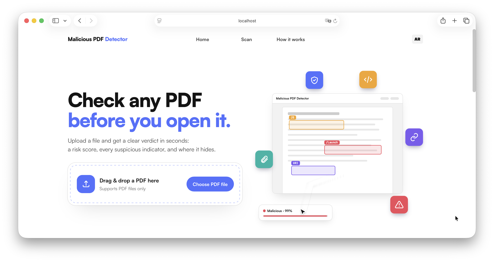

# Malicious PDF Detector

A web application that analyzes PDF files for potentially malicious content and suspicious behavior. Upload a PDF to view its risk score, categorized findings, and extracted scripts through an interactive React interface powered by a Python/Flask analysis engine.

The detector checks for embedded JavaScript, automatic actions, suspicious links, structural evasion techniques, anomalous metadata, and hidden execution indicators.



## Key Features

* **Drag-and-drop uploads**: Upload a PDF directly from your browser.
* **Five analysis modules**: Inspect text, content, document structure, metadata, and raw bytes.
* **Obfuscation detection**: Identify encoded PDF names, duplicate dictionary keys, and suspicious character or encoding patterns.
* **Parsing recovery**: Attempt to repair malformed PDFs and inspect decompressed streams.
* **Consolidated findings**: Merge duplicate indicators while preserving matched values and locations.
* **Risk assessment**: Display a weighted score, risk level, and status.
* **Script inspection**: Review extracted script content alongside the findings.

## Tech Stack

| Layer          | Technologies                       |
| -------------- | ---------------------------------- |
| Backend        | Python, Flask, Flask-Cors          |
| PDF processing | `pypdf`, `pikepdf`, `pdfminer.six` |
| Frontend       | React 19, Vite, Tailwind CSS       |
| UI utilities   | `react-dropzone`, `html-to-image`  |

## How It Works

1. **Upload**: The frontend sends the PDF to the Flask backend.
2. **Parse and recover**: The backend parses the file with `pypdf`. If parsing fails, it attempts a repair pass with `pikepdf` and extracts decompressed stream content.
3. **Extract and normalize**: Text is extracted with `pypdf`, using `pdfminer.six` as a fallback, then normalized to help identify obfuscated content.
4. **Analyze**: Five detector modules inspect the parsed document, extracted content, and raw bytes in parallel.
5. **Consolidate and score**: Duplicate findings are merged, and a weighted risk score is calculated.
6. **Display results**: The frontend presents the risk assessment, categorized findings, and extracted scripts.

### Detection Modules

| Module        | What it checks                                                                                                                                                                                                     |
| ------------- | ------------------------------------------------------------------------------------------------------------------------------------------------------------------------------------------------------------------ |
| **Text**      | Anomalies in the extracted text layer.                                                                                                                                                                             |
| **Content**   | Suspicious code and keywords, including `eval()` and `exec()`, character-code obfuscation, HTML script tags, potential command-and-control patterns, suspicious URLs, URL shorteners, and hacking-tool references. |
| **Structure** | Header anomalies, catalog entries, `/OpenAction`, the `/Names` tree, action objects, transparent form widgets, streams, hex-escaped names, and duplicate dictionary keys.                                          |
| **Metadata**  | Suspicious authoring tools or sources and implausible or potentially tampered timestamps.                                                                                                                          |
| **Binary**    | Embedded launch, open, and silent-execution strings that may not appear through normal object parsing.                                                                                                             |

Structural checks include actions such as `/Launch`, `/GoToR`, `/SubmitForm`, `/ImportData`, and `/URI`.

### Risk Scoring

Findings are deduplicated before scoring. Each finding ID contributes at most three times, with a capped severity contribution per finding.

The assessment includes:

| Field             | Output                                      |
| ----------------- | ------------------------------------------- |
| `risk_score`      | Weighted score calculated from the findings |
| `risk_percentage` | Normalized score from `0` to `100`          |
| `risk_level`      | `LOW RISK`, `MEDIUM RISK`, or `HIGH RISK`   |
| `status`          | `safe`, `warning`, or `danger`              |

Any critical-severity finding forces the risk level to **HIGH RISK**, regardless of the overall score.

## Project Structure

| Path                                 | Purpose                                                     |
| ------------------------------------ | ----------------------------------------------------------- |
| `backend/app.py`                     | Flask application and `/upload` endpoint                    |
| `backend/requirements.txt`           | Python dependencies                                         |
| `backend/analysis/signatures.py`     | Shared keywords and regex patterns                          |
| `backend/analysis/core/analyzer.py`  | Analysis pipeline, deduplication, and output assembly       |
| `backend/analysis/core/extractor.py` | Structured PDF content extraction                           |
| `backend/analysis/core/risk.py`      | Risk score, level, and status calculation                   |
| `backend/analysis/detectors/`        | Text, content, metadata, binary, and structural checks      |
| `backend/analysis/utils/`            | Normalization, script aggregation, text metrics, and models |
| `frontend/src/App.jsx`               | Upload interface, results view, and risk visualization      |
| `frontend/src/main.jsx`              | React entry point                                           |
| `frontend/src/index.css`             | Application styles                                          |

## Getting Started

### Prerequisites

* Python 3.10+
* Node.js 18+ and npm

### 1. Start the Backend

Create a virtual environment:

```bash
cd backend
python3 -m venv venv
```

Activate it on macOS or Linux:

```bash
source venv/bin/activate
```

Or on Windows Command Prompt:

```bat
venv\Scripts\activate
```

Install dependencies and start the API:

```bash
pip install -r requirements.txt
python app.py
```

The API runs at http://localhost:5000.

### 2. Start the Frontend

Open a separate terminal from the project root:

```bash
cd frontend
npm install
npm run dev
```

Open the URL shown by Vite.

Keep both servers running. 

The frontend sends analysis requests to the backend at `http://localhost:5000`.

## API Reference

### `GET /`

Returns the API health status.

**Example response**

```json
{
  "message": "Malicious PDF Detector API is running",
  "status": "OK"
}
```

### `POST /upload`

Uploads a PDF for analysis using `multipart/form-data`.

| Parameter | Type | Required | Description                |
| --------- | ---- | -------- | -------------------------- |
| `file`    | File | Yes      | The `.pdf` file to analyze |

**Size limits**

* Maximum upload size: **100 MB**
* Repaired or decompressed content analyzed: up to **200 MB**

**Example request**

```bash
curl -X POST http://localhost:5000/upload \
  -F "file=@example.pdf"
```

**Example response**

```json
{
  "filename": "example.pdf",
  "risk_score": 0,
  "risk_percentage": 0,
  "risk_level": "LOW RISK",
  "status": "safe",
  "findings": {
    "content": {
      "results": [],
      "count": 0
    },
    "structure": {
      "results": [],
      "count": 0
    },
    "metadata": {
      "results": [],
      "count": 0
    },
    "text_extraction": {
      "results": [],
      "count": 0
    },
    "binary": {
      "results": [],
      "count": 0
    }
  },
  "extracted_scripts": []
}
```

Each entry in a category's `results` array is a formatted string:

```text
[Severity: X/15] <description> | Location: <location>
```

## Limitations

This application uses heuristic detection to identify suspicious indicators. 

A low-risk result does not guarantee that a PDF is safe, and a flagged finding does not confirm malicious intent.

Use the results alongside sandbox analysis, antivirus or EDR scanning, and your organization's security procedures when handling untrusted PDFs.

## License

Copyright © 2026 Diyala Alturki. All rights reserved.

Use, copying, modification, and distribution require prior written
permission. See [LICENSE](LICENSE) for details.
